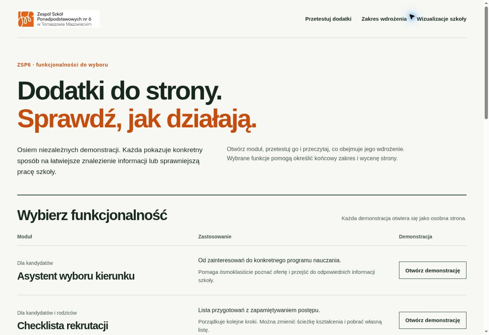

# Kontrola integracji dodatków ZSP6

Data: 23.11.2026. Środowisko: lokalny podgląd HTTP, Chromium.

## Wynik

- 9 stron HTML, 8 niezależnych modułów, 96 odnośników i lokalnych zasobów: poprawne.
- 24 pliki MJS: poprawna składnia.
- 8 istniejących plików testowych: Node raportuje 15 testów, 15 zaliczonych, 0 błędów. Część plików dodatkowo wykonuje własne asercje.
- Katalog dodatków sprawdzony przy szerokościach 360, 390, 768, 1024, 1440 i 1920 px. Brak poziomego przewijania, pojedynczy H1, brak kursywy w nagłówku.
- Wszystkie osiem modułów sprawdzono po integracji przy 360 px. Brak poziomego przewijania. Każdy link „Wróć do dodatków” rzeczywiście otworzył wspólny katalog.
- Asystent uruchomiony pod nową ścieżką. Wybór fotografii i rekrutacji wskazał technika fotografii i multimediów oraz oficjalne zasady przyjęcia.
- Desktop i mobile ocenione wizualnie. Moduły mają także wcześniejsze raporty sześciu szerokości i głównych interakcji, zachowane w ich QA.md.

[Pomiary przeglądarki](qa/layout-and-navigation.json) · [Pełny wynik kontroli kodu](test-results-current.txt)

## Ograniczenia

Kontrola integracji dotyczy podglądu lokalnego. Aktywacja GitHub Pages i weryfikacja publicznych adresów są osobnym etapem. Nie wykonano pełnego audytu WCAG ani testów na fizycznych telefonach, Safari, Firefox, NVDA i VoiceOver. Moduły są demonstracjami opisanymi w dokumentacji, bez backendu szkoły.
